# DarkShadow on Rust

**O [DarkShadow's Shell](https://github.com/shadowww-dev/DarkShadowShell) reescrito em Rust, num binário só (`dshell`), para Hyprland e driftwm.**

Sem EWW, sem GTK, sem Qt/QML. O `dshell` desenha tudo ele mesmo na CPU, direto em buffers de memória compartilhada do Wayland (layer-shell), e só redesenha o que mudou. O resultado é um shell que fica parado em ~0 % de CPU e usa poucos MB de memória própria.

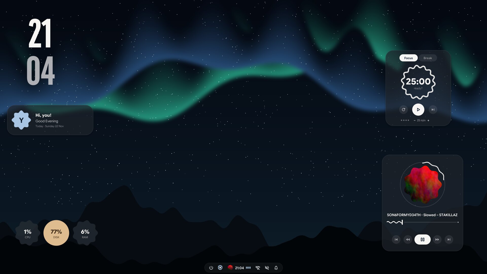

| Launcher (`ALT + Space`) | Central de controle (`SUPER + N`) |
|---|---|
| 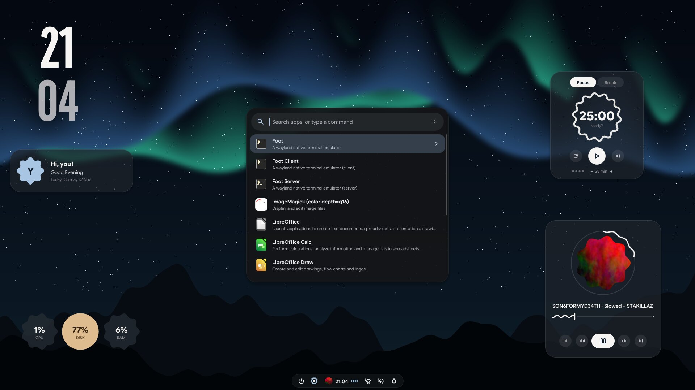 | 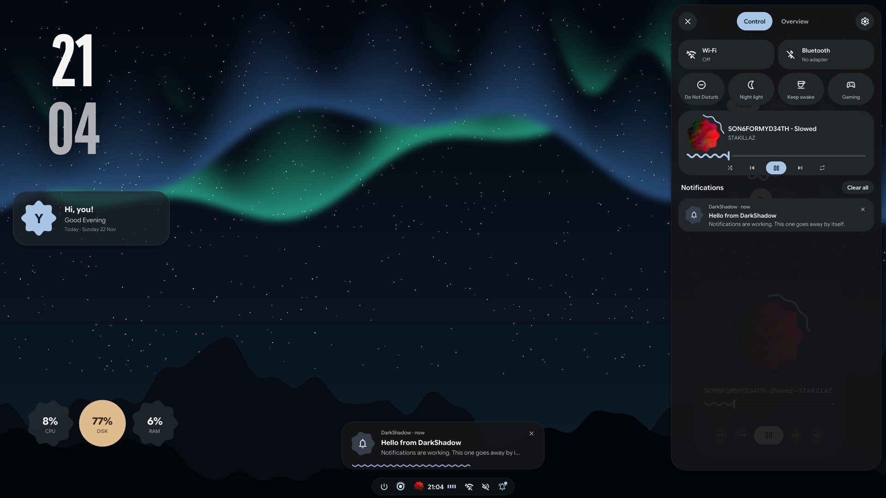 |
| **Hoje (clique na ilha)** | **Sistema (clique direito na ilha)** |
| 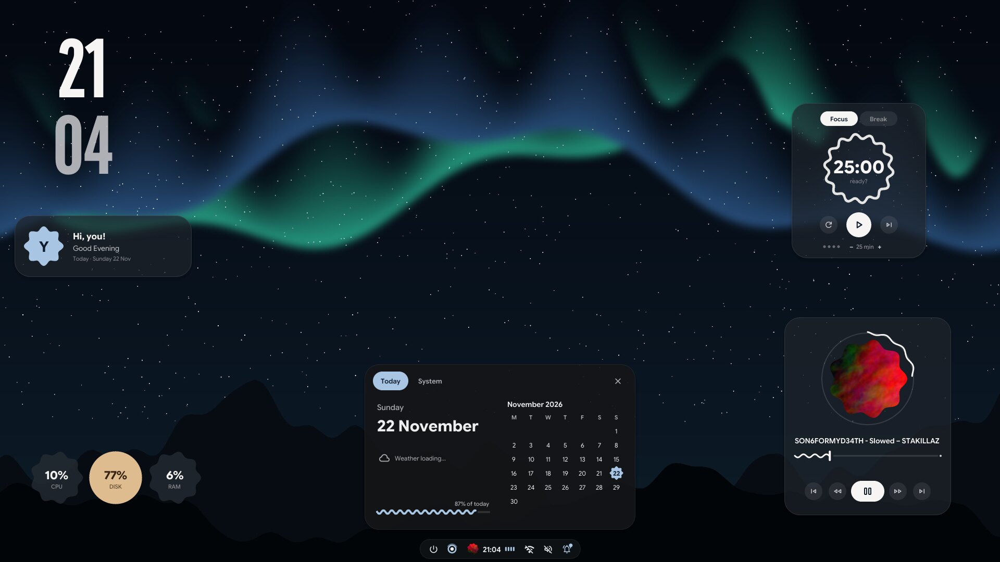 | 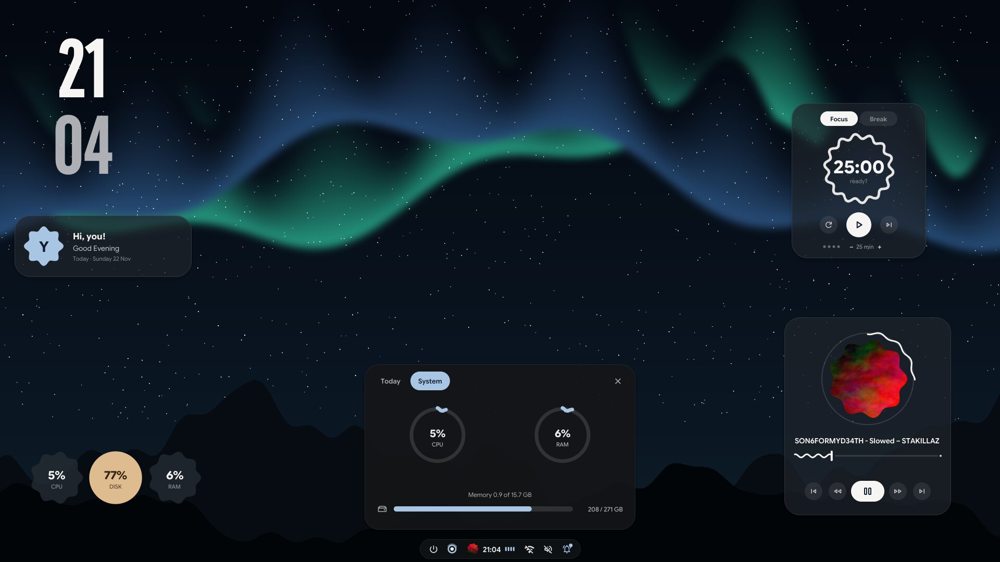 |
| **Player crescendo da ilha** | **Notificação na ilha** |
| 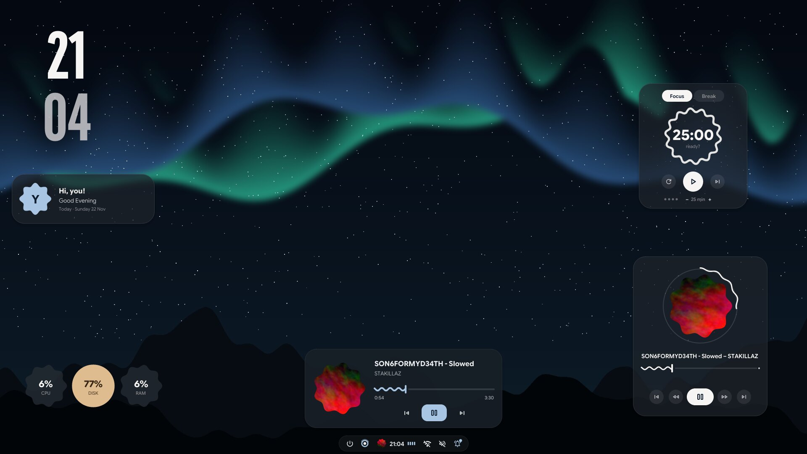 | 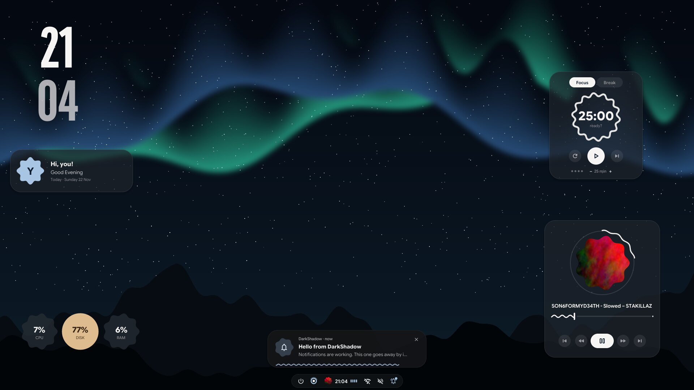 |
| **Configurações (`SUPER + U`)** | |
| 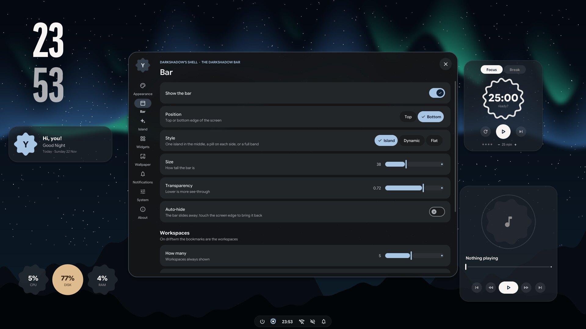 | |
| **Papéis de parede (`SUPER + W`)** | **Energia (`CTRL + ALT + Delete`)** |
| 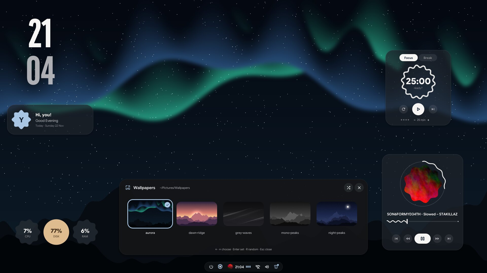 | 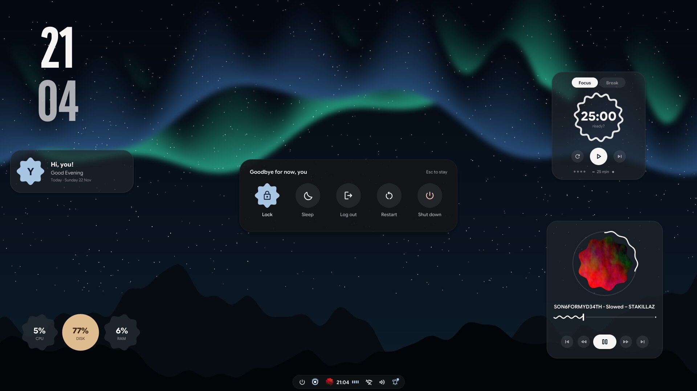 |

| Wi-Fi | Bluetooth |
|---|---|
| 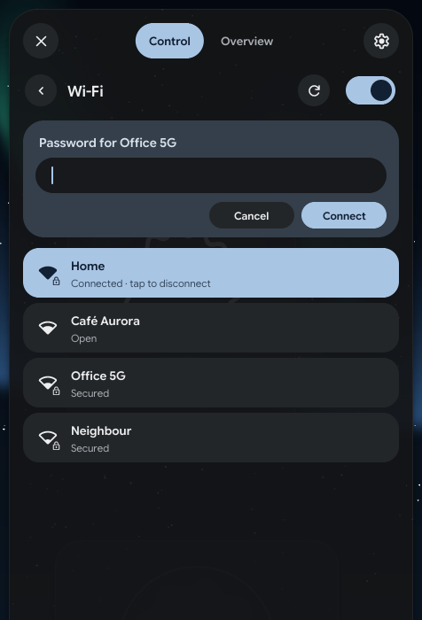 | 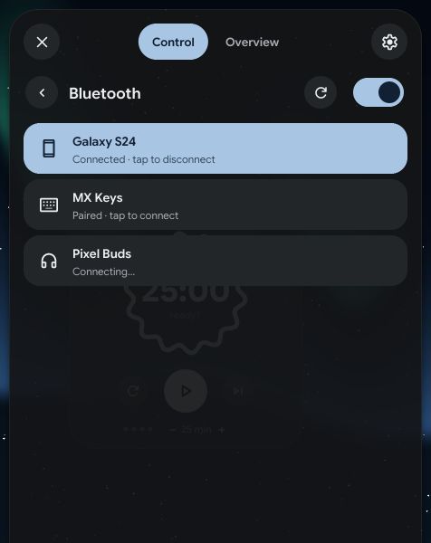 |

A ilha dinâmica vira o volume, o microfone, o brilho, o workspace ou o carregador por um instante:


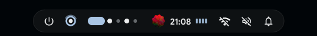
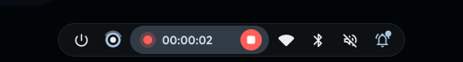


> As capturas vieram do `dshell` rodando de verdade (sway headless, renderização por software, com um player MPRIS de teste). O blur atrás dos cartões aparece no Hyprland/driftwm com as regras de `config/`.

---

## Desempenho

Medido a 1920×1080 com barra, 5 widgets, visualizador e papel de parede ativos, numa VM (Xeon 2,1 GHz, sem GPU):

| Situação | CPU (1 núcleo) | Memória própria (RSS anônima) | RSS total |
|---|---|---|---|
| Parado | **~0,1 %** | **~1,8 MiB** | ~25 MiB* |
| Música tocando (capa girando, ondas a 20 fps) | ~2,3 % | ~2 MiB | ~26 MiB* |
| Música tocando com janelas cobrindo a área de trabalho | ~0 % | ~2 MiB | — |
| Pico ao abrir o seletor de papéis de parede (decodificando JPEG 4K) | momentâneo | — | ~48 MiB, volta sozinho |

\* O total inclui ~10 MiB do próprio binário e da fonte (páginas de arquivo, compartilhadas e descartáveis) e ~12 MiB de buffers de tela que o compositor de teste (pixman) nunca devolve. Em compositores com GPU (Hyprland, driftwm) o buffer é devolvido logo após ser enviado à GPU, e o `dshell` libera essa memória depois de ~3 s parado.

Binário: ~8 MiB (4 MiB são a fonte Google Sans Flex embutida). Primeiro quadro na tela: ~40 ms.

### Por que é leve

- **Um processo, um loop.** Wayland, D-Bus, sockets do Hyprland/driftwm, `pactl subscribe`, timers e o IPC do próprio shell entram todos num único loop `calloop`, numa thread só. Não há runtime async nem threads paradas.
- **Tudo por evento, nada de polling:** workspaces pelo socket de eventos do Hyprland / `Subscribe` do driftwm; som pelo `pactl subscribe`; música, rede, Bluetooth, bateria e notificações por sinais D-Bus; config por inotify. O monitor de CPU/RAM só roda enquanto algo na tela mostra os números, e o visualizador (`cava`) só roda com música tocando.
- **Só redesenha o que mudou.** Cada superfície assina os tópicos que mostra (relógio, mídia, rede...). O relógio redesenha uma vez por minuto; o resto fica parado.
- **Animação só onde se mexe.** As partes paradas de um widget animado ficam num cache; a cada quadro só a capa e as ondas são redesenhadas, e o compositor recebe só essa área como "dano". Animações usam frame callbacks (superfície escondida não gasta nada) e ficam limitadas a 20 fps, como no original.
- **Rasterizador próprio** para o que o shell mais desenha (retângulos arredondados, anéis e ondas, capa girando): mistura de pixels em SWAR, de 2× a 8× mais rápido que um preenchimento de path genérico nesses casos (veja `examples/drawbench.rs`).
- **Memória devolvida.** Painéis só existem abertos; ao fechar, a superfície e seus buffers somem. Superfícies paradas devolvem seus buffers. O papel de parede é decodificado, copiado para o buffer e descartado. Buffers grandes vêm direto do `mmap` e voltam ao sistema na hora (`mallopt`), e miniaturas são decodificadas uma de cada vez.
- **Sem pilhas pesadas:** nada de toolkit gráfico, nada de TLS (clima e capas usam `curl`), D-Bus pela libdbus do sistema.

---

## O que tem

| Parte | Como no DarkShadow's Shell |
|---|---|
| **Tray** | ícones dos apps (StatusNotifierItem) na barra: o `dshell` é o watcher (ou usa o de outro programa); clique esquerdo ativa o app, direito abre o menu dele, os ícones somem quando o app fecha |
| **Barra** | estilo `island` (uma pílula no meio, padrão), `dynamic` (uma pílula por lado) ou `flat`; topo ou base; auto-ocultar; módulos: energia, launcher (o buraco negro), workspaces (pontos ou números), título da janela, ilha, mídia, rede, Bluetooth, volume (roda do mouse = volume), bateria, notificações |
| **Ilha dinâmica** | é o relógio (+ clima e uma mini onda quando toca música); vira volume/microfone/brilho (arrastável, onda), workspace e carregador; passe o mouse com música tocando e o player cresce dela; clique: Hoje; clique direito: Sistema; notificações aparecem como cartão saindo dela com uma onda que vai acabando |
| **Hoje / Sistema** | dia, clima, o dia como onda, calendário do mês; CPU, GPU (ou temperatura), RAM em anéis ondulados e o disco |
| **Widgets** | relógio expressivo (duas linhas altas), cartão "Hi, nome!", CPU · GPU · RAM em formas suaves, foco/pomodoro (Focus/Break, sol ondulado girando), player (capa girando numa forma, anel e linha onduladas, 5 botões), clima, calendário; cores claras/escuras conforme o papel de parede atrás de cada um; `dshell edit` para arrastar |
| **Visualizador** | barras, espelho, onda ou pontos; cor do tema, degradê, arco-íris ou branco (via `cava`) |
| **Launcher** | busca com pontuação (prefixo, palavra, letras em ordem), apps mais usados primeiro, ícones do tema, Enter roda o texto se nada combinar |
| **Central de controle** | brilho, volume, microfone; Wi-Fi e Bluetooth (a seta abre a lista: redes com força do sinal, salvas e protegidas, conectar com senha, desconectar; dispositivos com bateria, procurar, parear, conectar, desconectar); Não perturbe, Luz noturna, Manter acordado, Modo jogo; música com linha ondulada arrastável; lista de notificações; aba Visão geral (hora, calendário, clima, anéis) |
| **Notificações** | servidor `org.freedesktop.Notifications` próprio (ícones, imagens, ações, substituição, urgência) |
| **Papel de parede** | desenhado pelo shell, seletor com miniaturas, aleatório, as cores do shell inteiro seguem a imagem (cinza para imagens sem cor) |
| **Temas** | `auto` (da imagem), `grey` e os 19 esquemas do original (navy, mono, slate, ocean, teal, rose, violet...) ou qualquer cor; estilos de widget `google`, `shadow` (vidro) e `outline`; sua forma (verysunny, cookie, flower, clover...) |
| **Captura e gravação** | `Print` região, `SHIFT + Print` tela inteira (salva em `~/Pictures/Screenshots` e copia); `SUPER + SHIFT + R` grava uma região, `SUPER + ALT + R` a tela com som (em `~/Videos/Recordings`); enquanto grava, a ilha mostra o tempo e o botão de parar |
| **Energia** | bloquear, suspender, sair, reiniciar, desligar (teclado ou mouse) |
| **Configurações** | janela própria (`SUPER + U` ou a engrenagem): Aparência, Barra, Ilha, Widgets, Papel de parede, Notificações, Sistema e Sobre, com interruptores, escolhas, sliders e as cores/formas como fichas; tudo vale na hora e só as opções que você mexeu são gravadas no `config.toml` |

### Diferenças do original (e por quê)

- **Configurações:** a janela de Configurações cobre as opções do shell; o que ela não mostra (módulos da barra, posições exatas, comandos) fica no `config.toml`, recarregado ao salvar. Ainda não há busca nas configurações.
- **Ainda não feito:** dock, task view, game bar, área de transferência, letras de música, sons de interface, tela de bloqueio própria (usa hyprlock/swaylock), tema do SDDM, intro de boas-vindas.
- **Compositores:** Hyprland e driftwm (no driftwm os bookmarks fazem o papel de workspaces). niri não é suportado.
- **Ícones:** os Material Symbols usados vêm embutidos como vetores (sem precisar da fonte instalada).

---

## Instalação

### NixOS (flake)

```nix
# flake.nix do sistema
inputs.dshell.url = "github:pabl0conepc-alt/DarkShadow-on-rust-";
# ...
modules = [
  ./configuration.nix
  dshell.nixosModules.default
  { programs.dshell.enable = true; }
];
```

O módulo instala o `dshell` (com `wpctl`, `pactl`, `cava`, `curl` no PATH dele), liga NetworkManager, Bluetooth, UPower e PipeWire, e instala `wlsunset`/`hyprsunset` para a luz noturna. Depois, ligue o shell no compositor (abaixo). Para testar sem instalar: `nix run github:pabl0conepc-alt/DarkShadow-on-rust-`.

### Arch, CachyOS, Fedora, Debian/Ubuntu

```bash
git clone https://github.com/pabl0conepc-alt/DarkShadow-on-rust- && cd DarkShadow-on-rust-
./install.sh
```

Instala as dependências, compila, coloca o binário em `~/.local/bin`, copia os papéis de parede para `~/Pictures/Wallpapers` (se a pasta estiver vazia), cria `~/.config/dshell/config.toml` e liga o shell no Hyprland (com backup do seu arquivo).

### Ligar no compositor

- **Hyprland 0.55+ (config em Lua):** copie `config/hypr/dshell.lua` para `~/.config/hypr/` e adicione `require("dshell")` ao `hyprland.lua`.
- **Hyprland antigo (hyprland.conf):** `source = ~/.config/hypr/dshell.conf` (arquivo em `config/hypr/dshell.conf`).
- **driftwm:** junte `config/driftwm/dshell.toml` ao seu `~/.config/driftwm/config.toml` (autostart, regras de blur e atalhos).

Esses arquivos ligam o blur atrás dos cartões e as teclas abaixo.

## Atalhos

| Teclas | Ação |
|---|---|
| `ALT + Space`, `SUPER + R` | launcher |
| `SUPER + N`, `SUPER + A` | central de controle |
| `SUPER + U` | configurações |
| `SUPER + W` | papéis de parede (ou clique direito na área de trabalho) |
| `SUPER + ALT + D` | Hoje (o cartão da ilha) |
| `SUPER + ALT + W` | mover os widgets com o mouse (de novo para terminar) |
| `Print` / `SHIFT + Print` / `SUPER + SHIFT + S` | captura de região / tela inteira / região |
| `SUPER + SHIFT + R` / `SUPER + ALT + R` | gravar região / tela com som (de novo para parar) |
| `SUPER + G` | modo jogo (sem movimento, sem blur, sem visualizador) |
| `CTRL + ALT + Delete` | menu de energia |
| `SUPER + L` | bloquear |
| teclas de volume / brilho / mídia | aparecem na ilha |

No launcher: digite para buscar, `↑/↓`/`Tab` para escolher, `Enter` para abrir, `Ctrl+U` limpa, `Esc` fecha.

## Linha de comando

```
dshell                          inicia o shell
dshell toggle|open|close <p>    launcher | control | settings | power | picker | today | system | player   (close all)
dshell volume up|down|mute|set N        dshell mic mute
dshell brightness up|down|set N         dshell media play-pause|next|prev
dshell wallpaper set <arquivo>|next|random
dshell scheme auto|grey|navy|...|#rrggbb
dshell notifs clear|dnd|test            dshell ws <n>|next|prev
dshell shot region|full|window          dshell record region|full|full-sound|region-sound|stop
dshell edit | gaming | lock | reload | quit | status
dshell config                   escreve o exemplo em ~/.config/dshell/config.toml
```

`dshell status` mostra o que o shell está vendo, quantas vezes cada superfície foi desenhada, o tempo médio de cada quadro e a memória.

## Configuração

Tudo em `~/.config/dshell/config.toml` ([exemplo comentado](config/dshell/config.toml)); só escreva o que quiser mudar. Exemplo:

```toml
[theme]
scheme = "rose"
widget_style = "shadow"

[bar]
position = "top"
style = "dynamic"
right = ["media", "network", "volume", "battery", "notifications"]

[widgets.player]
anchor = "br"
x = 40
y = 40
```

---

## Arquitetura

```
src/
  app.rs        Wayland: superfícies layer-shell, buffers, entrada; o loop
  gfx.rs        canvas (tiny-skia + cache de camadas paradas), formas Material 3, imagens
  raster.rs     rasterizadores rápidos (retângulo arredondado, anéis/ondas, capa girando)
  text.rs       Google Sans Flex variável (ab_glyph) com cache de glifos
  theme.rs      paletas derivadas de uma cor (as fórmulas HSL do original), cor do papel de parede
  shell.rs      quais superfícies existem, relógio, recarga da config, papel de parede
  actions.rs    cliques, teclas, CLI, ilha, notificações
  ui/           barra + ilha, cartão da ilha, launcher, central, energia, seletor, widgets, papel de parede
  svc/          hypr, drift (driftwm), audio (wpctl/pactl), bus (MPRIS, notificações, NetworkManager,
                BlueZ, UPower, logind), sysmon, weather (wttr.in), viz (cava), apps (.desktop + ícones), images
```

Desenvolvimento:

```bash
cargo build --release
cargo test
cargo run --release --example drawbench     # tempo de cada primitiva de desenho
cargo run --release --example mpris_mock    # um player MPRIS falso para testar a mídia
cargo run --release --example sysbus_mock   # NetworkManager + BlueZ falsos (com DBUS_SYSTEM_BUS_ADDRESS)
cargo run --release --example sni_mock      # dois ícones de tray falsos
```

## Créditos

- **[DarkShadow's Shell](https://github.com/shadowww-dev/DarkShadowShell)** de **shadowww-dev** (MIT): o design inteiro (a barra e a ilha dinâmica, os widgets, a central de controle, o launcher, as paletas, os esquemas de cor), o comportamento e os **papéis de parede** em `assets/wallpapers/`. Ele por sua vez credita Sarods2D (Infinite Desktop, Iridium) e fedyaqq34356 (a ideia da ilha).
- **[Google Sans Flex](https://fonts.google.com)** (SIL OFL 1.1, `assets/fonts/LICENSE`) e **[Material Symbols](https://github.com/google/material-design-icons)** (Apache-2.0).
- **[smithay-client-toolkit](https://github.com/Smithay/client-toolkit)**, **[tiny-skia](https://github.com/linebender/tiny-skia)**, **[ab_glyph](https://github.com/alexheretic/ab-glyph)**, **[resvg](https://github.com/linebender/resvg)**, **[dbus-rs](https://github.com/diwic/dbus-rs)**, **[image](https://github.com/image-rs/image)**.
- **[driftwm](https://github.com/malbiruk/driftwm)** e **[Hyprland](https://hypr.land)**; **[cava](https://github.com/karlstav/cava)**; **[wttr.in](https://wttr.in)**.

## Licença

MIT (veja `LICENSE`), como o DarkShadow's Shell original.
